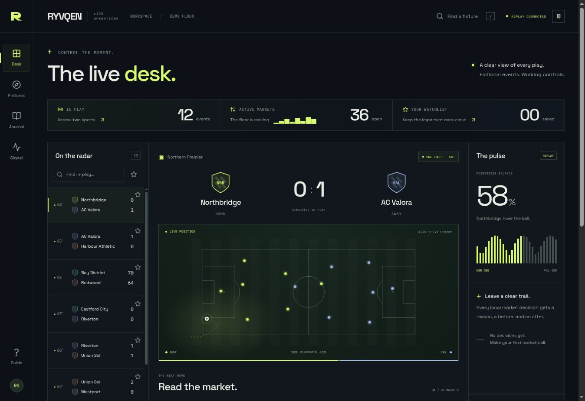

# RYVQEN

**Follow the play. Shape the market. Keep the record.**

An original React/TypeScript sports operations desk by **Rafayel Karamyan**.
Choose a fictional event, follow an animated tracker, set manual decimal prices,
pause a market and review the exact decision in a durable local journal.

[Live demo](https://rafayelkaramyan.github.io/ryvqen/) ·
[Verified release](https://github.com/RafayelKaramyan/ryvqen/actions/runs/39644755085) ·
[Code walkthrough](docs/review-guide.md)



## Explore

- **The desk:** twelve in-play events, illustrative football/basketball trackers,
  feed trends, possession and working market controls.
- **Fixtures:** 240 fictional fixtures, search, sport/status filters, watchlists,
  URL state and a virtual scrolling list with a paginated keyboard alternative.
- **The journal:** required reasons, before/after values, action filters and JSON
  export. The newest 200 successful decisions persist in this browser.
- **The signal:** actual session counters and controls for duplicate frames,
  late frames, gaps, reconnection and a rejected market request.
- **Field guide:** interaction notes, authorship, data boundaries and font credits.

All data is synthetic. The public build uses a dedicated browser worker; it needs
no account, secret, external sports API or hosted backend. The separately runnable
Node.js WebSocket server uses the same strict protocol. There are no real wagers,
payments, shared operator accounts or external trading actions.

## Run locally

Node.js 24 is used in CI.

```bash
npm ci
npm run dev
```

Open `http://127.0.0.1:4173/ryvqen/`.

To exercise an actual local WebSocket transport, start the server in one terminal:

```bash
npm run feed
```

Then start the client in another terminal:

```bash
VITE_FEED_URL=ws://127.0.0.1:8787 npm run dev
```

The server binds to loopback and accepts local development browser origins.
It is a demonstration feed, not a production trading service.

## Verify

```bash
npm run check
npm run build
npm run test:e2e
```

`check` runs strict types, zero-warning ESLint, formatting and the unit/integration
suite. Browser tests require Playwright Chromium and Firefox. GitHub Actions
installs those browsers, runs all checks and publishes the static build only
after verification succeeds.

The Pages base is `/ryvqen/`; hash routes support direct event links.
The verified release passed **46 unit/integration tests and 42 browser cases**:
fourteen scenarios each in Chromium, Firefox and Pixel 7 Chromium. Strict types,
zero-warning lint, formatting and the production build passed in the same run.
Live manual-price persistence, journal details and the export action were also
checked on the deployed demo. See [executed validation](docs/validation.md) for
the exact commit, screenshots, coverage and remaining limits.

## Engineering notes

- [Architecture and tradeoffs](docs/architecture.md)
- [Code walkthrough and interview preparation](docs/review-guide.md)
- [Design and interaction brief](docs/design.md)
- [Third-party notices](THIRD_PARTY_NOTICES.md)

Manual prices are separate from feed prices. A local suspension always takes
precedence; returning prices to the feed does not silently resume a market.
Incremental messages are accepted only in sequence. Gaps request a fresh snapshot,
and stale feeds cannot authorize a market change. Writes are acknowledged only
after durable local storage succeeds.
